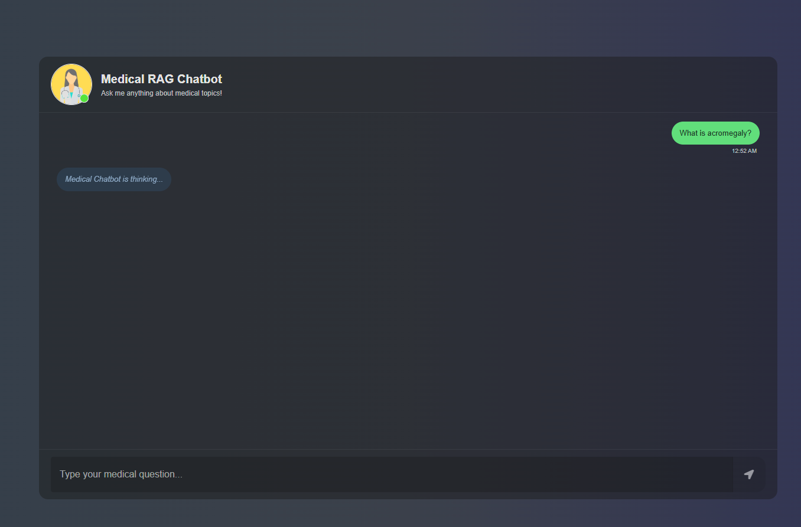
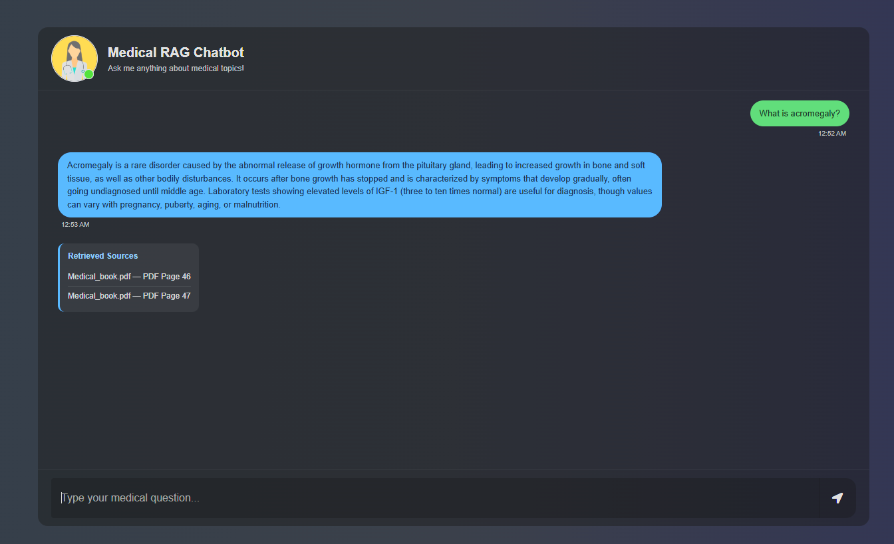

# 🩺 Medical RAG Chatbot

### AI-Powered Medical Question Answering with LangChain, Pinecone & Ollama

A medical question-answering chatbot built using **Retrieval-Augmented Generation (RAG)**. The application retrieves relevant passages from a medical reference PDF and uses a locally hosted Large Language Model (LLM) to generate context-aware answers.

The project demonstrates an end-to-end RAG workflow, including PDF processing, text chunking, semantic embeddings, vector storage, retrieval, LLM integration, and a Flask-based chat interface.

> **Medical Disclaimer:** This application is an educational prototype. Its source material may be outdated, and its responses may be inaccurate or incomplete. It is not intended for diagnosis, treatment, or clinical decision-making. Always consult a qualified healthcare professional for medical advice.

## Features

- **PDF Knowledge Base:** Processes medical reference documents into smaller text chunks.
- **Semantic Embeddings:** Uses `sentence-transformers/all-MiniLM-L6-v2` to represent text as 384-dimensional vectors.
- **Vector Search:** Stores and retrieves embeddings using Pinecone.
- **Local LLM:** Generates responses using `qwen3:4b-instruct` through Ollama.
- **RAG Pipeline:** Combines retrieved document context with an LLM using LangChain.
- **Web Chat Interface:** Provides an interactive Flask application with HTML, CSS, Bootstrap, and JavaScript.
- **Source References:** Displays the retrieved PDF filename and page numbers.
- **Loading Indicator:** Shows processing status while the assistant generates an answer.

## Application Screenshots

### 1. Processing a Medical Question

The chatbot displays a loading indicator while retrieving relevant medical information and generating a response using the local LLM.



### 2. Generated Answer with Retrieved Sources

The chatbot displays the generated answer alongside the retrieved PDF pages used as supporting context.



## RAG Architecture

```text
             Medical Reference PDF
                       |
                 PDF Loading
                       |
                 Text Chunking
                       |
              Hugging Face Embeddings
                       |
                Pinecone Vector DB
                       |
                       v
User Question --> Query Embedding
                       |
                Similarity Search
                       |
             Retrieved PDF Passages
                       |
                       v
                Prompt + Context
                       |
             Ollama (Qwen3 4B)
                       |
                Generated Answer
                       |
                Flask Chat UI
                       |
              Answer + References
```

## Tech Stack

| Component              | Technology                               |
| ---------------------- | ---------------------------------------- |
| Programming Language   | Python                                   |
| Backend                | Flask                                    |
| RAG Framework          | LangChain                                |
| Local LLM              | Ollama — `qwen3:4b-instruct`             |
| Embedding Model        | `all-MiniLM-L6-v2`                       |
| Vector Database        | Pinecone                                 |
| PDF Processing         | PyPDF, LangChain                         |
| Frontend               | HTML, CSS, Bootstrap, JavaScript, jQuery |
| Research & Experiments | Jupyter Notebook                         |

## Project Structure

```text
Medical-RAG-Chatbot/
├── app.py
├── store_index.py
├── requirements.txt
├── requirements-dev.txt
├── .env.example
├── .gitignore
├── README.md
├── assets/
│   └── screenshots/
│       ├── M1.png
│       └── M2.png
├── data/
│   └── Medical_book.pdf      # Local only; not included in Git
├── research/
│   └── medical_rag_experiments.ipynb
├── src/
│   ├── __init__.py
│   ├── helper.py
│   ├── prompt.py
│   └── rag_chain.py
├── static/
│   └── style.css
└── templates/
    └── chat.html
```

## Installation and Setup

### 1. Clone the Repository

```bash
git clone https://github.com/YOUR_USERNAME/Medical-RAG-Chatbot.git
cd Medical-RAG-Chatbot
```

Replace `YOUR_USERNAME` with your actual GitHub username.

### 2. Create a Virtual Environment

```bash
python -m venv .venv
```

Activate it on Windows using Git Bash:

```bash
source .venv/Scripts/activate
```

### 3. Install Dependencies

```bash
python -m pip install -r requirements.txt
```

### 4. Configure Environment Variables

Copy `.env.example` to `.env`:

```bash
cp .env.example .env
```

Configure the following variables:

```env
PINECONE_API_KEY=your_pinecone_api_key_here
HF_TOKEN=your_huggingface_token_here
```

The Hugging Face token is optional when accessing public models without authentication.

Never commit real API keys or environment secrets to GitHub.

### 5. Install and Configure Ollama

Install Ollama from [ollama.com](https://ollama.com).

Download the local language model:

```bash
ollama pull qwen3:4b-instruct
```

Ensure the Ollama service is running before starting the application.

### 6. Configure Pinecone

Create or use a compatible Pinecone index with the following configuration:

- **Index name:** `medicalbot`
- **Vector field:** `vector`
- **Dimensions:** `384`
- **Similarity metric:** `cosine`
- **Namespace:** `medical-rag`
- **Index type:** Dense vector index

The project uses the Pinecone Documents API for vector storage and similarity search.

Pinecone is a hosted service and may have usage limits or costs depending on the account and plan.

### 7. Prepare the Knowledge Base

Place a medical PDF that you are authorized to use at:

```text
data/Medical_book.pdf
```

Generate embeddings and upload the document chunks to Pinecone:

```bash
python store_index.py
```

The ingestion process extracts the PDF text, splits it into chunks, generates embeddings, and stores the vectors with source metadata.

**Note:** The medical reference PDF is not distributed with this repository. Users must provide their own authorized copy. A different document may produce different retrieval and answer quality.

The ingestion script should be run when initially preparing the knowledge base or intentionally updating the indexed documents; it is not required for every application startup.

### 8. Run the Flask Application

```bash
python app.py
```

Open the application in your browser:

http://127.0.0.1:8080

## How It Works

1. **Document Processing:** Loads and extracts text from the medical reference PDF.
2. **Text Splitting:** Uses `RecursiveCharacterTextSplitter` with a chunk size of `500` and overlap of `20`.
3. **Embedding Generation:** Converts text chunks into 384-dimensional embeddings.
4. **Vector Indexing:** Stores embeddings and associated metadata in Pinecone.
5. **Question Processing:** Embeds each user question using the same embedding model.
6. **Document Retrieval:** Searches Pinecone for the top three similar document chunks.
7. **Answer Generation:** Supplies retrieved context to a local Qwen model through LangChain and Ollama.
8. **Response Presentation:** Returns the generated answer and retrieved document references to the Flask interface.

## Research and Experiments

The `research/medical_rag_experiments.ipynb` notebook documents the development and experimentation process.

The research explored:

- PDF text extraction and preprocessing.
- Text chunking strategies.
- Embedding generation.
- Semantic similarity search.
- Local vector retrieval using FAISS.
- Cross-encoder reranking.
- Retrieval quality and limitations.

These experiments are separate from the current application pipeline.

**Current application:** Pinecone with the original 500-character chunking strategy and top-3 retrieval.

Experimental approaches should not be interpreted as production features unless explicitly integrated into the application.

## Limitations

- Answers depend on the quality and coverage of the supplied medical PDF.
- The original reference document may contain outdated medical information.
- Semantic similarity does not guarantee that retrieved passages directly answer the question.
- LLM-generated responses may include unsupported statements despite RAG grounding.
- Displayed references identify retrieved documents, not independently verified medical citations.
- The current application is a local prototype and is not production-hardened.
- A configured Pinecone account and a running local Ollama model are required.
- The application does not replace qualified medical professionals or validated clinical decision-support systems.

## Future Improvements

- Integrate more current, trusted medical information sources.
- Improve retrieval quality and evaluate answer grounding.
- Add systematic RAG evaluation and benchmarking.
- Improve document ingestion and indexing synchronization.
- Explore hybrid search, reranking, and alternative embedding models.
- Enhance source attribution and response validation.
- Add improved error handling and application-level logging.
- Explore deployment options that preserve the local LLM architecture.

## Author

**Maen Qawasmeh**

Computer Science | AI & Machine Learning

[LinkedIn](https://www.linkedin.com/in/maen-qawasmeh-951ba0211/)

## License and Data

The application's software license has not yet been selected.

The medical reference PDF is not included in this repository. Users are responsible for obtaining and using documents they are authorized to process.

This project is intended for educational and portfolio purposes only.
